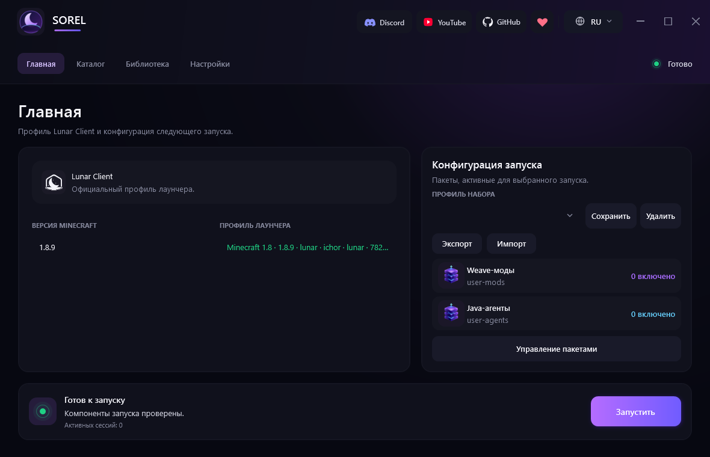
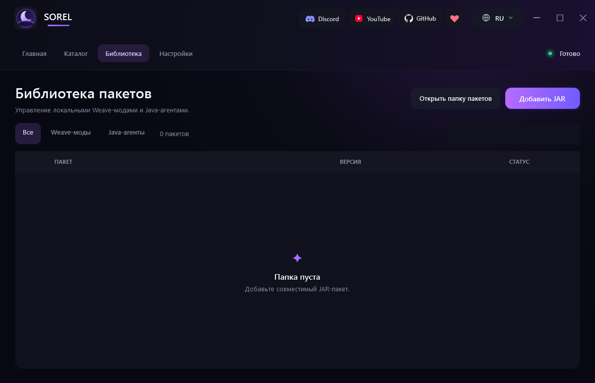
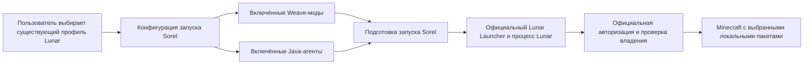
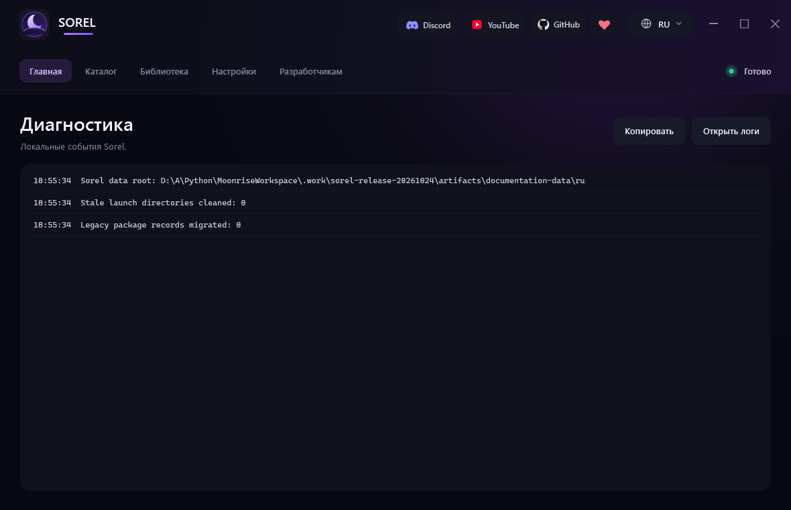

<p align="center">
  
</p>

<h1 align="center">Sorel</h1>

<p align="center"><strong>Современный менеджер модов и лаунчер для Lunar Client.</strong></p>

<p align="center">
  <a href="README.md">English</a> | <strong>Русский</strong> | <a href="docs/roadmap.md"><strong>Roadmap</strong></a>
</p>

<p align="center">
  <a href="https://github.com/ZOONGG/Sorel/actions/workflows/build.yml"></a>
  <a href="https://github.com/ZOONGG/Sorel/releases"></a>
  <a href="LICENSE"></a>
  
  
</p>



## Что такое Sorel

Sorel — открытое приложение для Windows, которое запускает существующие официальные профили Lunar Client с локальными Weave-модами и Java-агентами. Оно упорядочивает пакеты, готовит изолированную конфигурацию запуска и передаёт запуск официальному Lunar Launcher.

Sorel дополняет официальный лаунчер, а не заменяет его. Приложение не реализует авторизацию, не загружает Lunar Client и не создаёт сессии Minecraft. Пользователь входит в аккаунт через официальный Lunar Launcher; авторизация и проверка владения остаются внутри официальных компонентов Lunar.

## Основные возможности

- Обнаружение официального Lunar Launcher и чтение метаданных существующих профилей Lunar.
- Выбирает существующий профиль Minecraft 1.8.9.
- Импорт, проверка структуры, включение, отключение и удаление локальных Weave-модов и Java-агентов.
- Сохранение, применение, импорт и экспорт локальных наборов запуска без включения JAR-файлов.
- Содержит встроенный офлайн-каталог Cosmetics/Veyra и поддерживает дополнительные проверяемые удалённые каталоги.
- Загрузка официального Weave Loader 1.3.4 по требованию с проверкой SHA-256 и точки входа в манифесте.
- Проверка заявленной совместимости пакетов перед запуском и безопасный режим без сторонних пакетов.
- Локальная диагностика с маскированием распространённых форматов токенов и локальный отчёт после аварийного завершения игры.
- Равнозначный интерфейс на русском и английском языках.
- Контролирует жизненный цикл запуска и очистку; повторное открытие активирует существующий экземпляр Sorel.
- Содержит настройки запуска, установщик и интерфейс beta-обновлений Velopack для подходящих установок.

<p align="center">
  
  
</p>

На снимках экрана показаны синтетические метаданные пакетов, созданные только для документации. Эти примеры не поставляются; текущий каталог отдельно включает Cosmetics и Veyra.

## Как работает Sorel



Sorel читает базу профилей официального лаунчера, меняет только параметр выбранного профиля `gameProfile`, создаёт временный снимок включённых пакетов и запускает официальный лаунчер. Выбор аккаунта, авторизация, проверка владения, загрузки и создание сессии остаются обязанностью официального лаунчера.

## Требования

- Windows 10/11 x64; реальные проверки выполнены в среде Windows x64 пользователя и не сертифицируют каждую сборку Windows.
- Установленный официальный Lunar Launcher, вход в аккаунт и хотя бы один запуск Minecraft **1.8.9**.
- Существующий профиль Lunar 1.8.9 и доверенные пакеты, совместимые с этой сборкой.

Зафиксированная версия Lunar Launcher — **3.7.23-ow** (ProductVersion 3.7.23.0), Java Lunar — **17.0.18**. Текущий объём поддержки ограничен Minecraft **1.8.9**. После обновлений Lunar совместимость нужно проверять повторно. Самодостаточные сборки включают .NET 8; для сборки исходников нужен SDK.

## Установка

**Публичный релиз пока не опубликован.** Владелец вручную разместит файлы на [GitHub Releases](https://github.com/ZOONGG/Sorel/releases). Сейчас эта ссылка не означает доступность скачивания.

Когда релиз появится:

1. Прочитайте примечания и выберите поставляемый с ним установщик Windows x64.
2. Перед запуском сравните SHA-256 с опубликованной контрольной суммой:

   ```powershell
   (Get-FileHash .\Sorel.App-stable-Setup.exe -Algorithm SHA256).Hash
   Get-Content .\Sorel.App-stable-Setup.exe.sha256
   ```

3. Запустите `Sorel.App-stable-Setup.exe` и откройте Sorel через ярлык. Velopack устанавливает приложение для текущего пользователя в `%LOCALAPPDATA%\Sorel.App` без прав администратора.
4. Этот производственный установщик **Velopack** поддерживает beta-обновления. Старые Inno-установки не переходят на Velopack автоматически. `Sorel.UpdateSmoke` предназначен только для локальных тестов и не публикуется.

Если релиз содержит ZIP, его можно использовать без установки: распакуйте **весь** архив в доступную для записи папку и запустите `Sorel.exe`. В ZIP нет встроенных обновлений Velopack. Несмотря на историческое имя `Portable` и файл-маркер, текущие сборки хранят настройки и пакеты в `%LOCALAPPDATA%\Sorel`, а не рядом с EXE. Подробнее: [установка](docs/INSTALLER.md), [поведение ZIP](docs/PORTABLE_MODE.md), [обновления](docs/UPDATES.md).

Подготовленные установщики не подписаны; Windows может показать SmartScreen. Проверьте источник и контрольную сумму. Самодостаточные пакеты не требуют отдельной установки .NET.

## Автоматические обновления

Установленные через **Velopack** сборки проверяют публичный источник [Sorel GitHub Releases](https://github.com/ZOONGG/Sorel/releases) при запуске, если включена **Проверка обновлений**. Текущий канал — **beta**: принимаются только более новые версии `-stable versions`, включая опубликованные prerelease; понижение версии запрещено. Переключение на стабильный канал не реализовано.

Для ручной проверки откройте **Настройки → Обновления**. **Автоматически скачивать обновления** включено по умолчанию; отключите его, чтобы самостоятельно нажимать **Скачать**. Sorel показывает доступную версию, прогресс и уведомление о готовности к перезапуску. Velopack проверяет пакет и сохраняет его в папке пакетов установки.

После загрузки завершите Minecraft и текущие операции Sorel, затем нажмите **Установить и перезапустить**. Загруженное обновление также может примениться при следующем запуске через проверяемый Sorel механизм. Безусловное startup auto-apply Velopack отключено. Перед перезапуском очищаются ресурсы приложения и трея; активный запуск/игра и операции блокируют применение. Настройки и установленные пакеты остаются в отдельной папке данных LocalAppData; updater не переносит и не заменяет её. Сохранность данных при реальном installed-update и восстановление после ошибки применения ещё требуют приёмочной проверки.

Нужны настоящая установка Velopack, доступ к публичному GitHub и вручную опубликованные согласованные stable feed/package assets (`releases.stable.json` и полный `.nupkg`). В ZIP, Inno и dev-сборках обновления Velopack отключены. До публикации релиза владельцем производственного feed нет. Подробнее: [обновления](docs/UPDATES.md).

## Первый запуск

1. Установите официальный Lunar Launcher.
2. Войдите в аккаунт через официальный Lunar Launcher.
3. Хотя бы один раз создайте или запустите нужный профиль/версию Lunar Client.
4. Полностью закройте официальный лаунчер, когда Sorel попросит это сделать.
5. Запустите Sorel.
6. Выберите точную версию Minecraft существующего профиля Lunar.
7. Добавьте доверенные Weave-моды и/или Java-агенты.
8. Включите пакеты, необходимые для этого запуска.
9. Нажмите **Запустить**.
10. Если появится запрос, завершите авторизацию или проверку владения в официальных компонентах Lunar.

Sorel не запрашивает и не управляет учётными данными Microsoft, Minecraft или Lunar.

## Добавление Weave-модов

1. Откройте **Библиотека → Weave-моды**.
2. Нажмите **Добавить JAR** и выберите один или несколько доверенных JAR-файлов Weave-модов.
3. Проверьте обнаруженные название и версию.

Sorel требует файл `weave.mod.json` и читает из него общие метаданные пакета. Проверка структуры при импорте не означает, что код безопасен или совместим.

## Добавление Java-агентов

1. Откройте **Библиотека → Java-агенты**.
2. Нажмите **Добавить JAR** и выберите один или несколько доверенных JAR-файлов агентов.
3. Проверьте обнаруженные название и версию.

Импорт распознаёт `Premain-Class` или `Agent-Class` в `META-INF/MANIFEST.MF`, но подключение при запуске через `-javaagent` требует корректного `Premain-Class`. Одного `Agent-Class` для attach недостаточно.

> [!WARNING]
> Моды и Java-агенты являются исполняемым кодом. Загружайте JAR-файлы только из источников, которым доверяете.

## Включение и удаление пакетов

- Переключатель рядом с пакетом включает или исключает его из следующих запусков.
- Удаление убирает выбранную копию из библиотеки Sorel; сохраняйте резервные копии импортированных оригиналов.
- Наборы запуска сохраняют выбор версии и пакетов; экспорт содержит метаданные, а не JAR-файлы.
- Можно перетащить JAR в приложение либо открыть папку данных и поместить Weave-моды в `packages/weave/`, агенты — в `packages/agents/`. Новые файлы обнаруживаются автоматически; не редактируйте `packages/metadata/` вручную.

## Каталог пакетов

Встроенный каталог содержит **Sorel Cosmetics 1.3.2** и **Veyra 1.0.1** из проверенных файлов сборки с проверкой SHA-256 и установкой без сети. Откройте **Каталог**, выберите пакет, подтвердите установку и включите его в **Библиотеке**. Для этих встроенных версий отдельная ссылка на скачивание не нужна.

Дополнительные удалённые каталоги проходят отдельные проверки подписи, источника и хеша. Подпись и хеш подтверждают целостность, а не безопасность или совместимость. Пакеты с внешним источником и недоступные пакеты нельзя считать устанавливаемыми в один клик.

### Sorel Cosmetics

Наш Java-агент локально разблокирует и отображает косметику Lunar, сохраняет её хранилища при кратковременном переподключении и сохраняет/восстанавливает выбранные образы в `%LOCALAPPDATA%\Sorel\cosmetics`. Версия **1.3.2** подтверждена манифестом, исходниками/сборкой и хешем встроенного каталога. Агент включает ASM и работает без Weave-модов и загрузчика. Включите его в библиотеке Java-агентов и запустите поддерживаемый профиль Lunar 1.8.9; пользователь подтвердил локальную косметику в отдельном запуске и регрессионную проверку обычного режима на указанной версии Lunar.

Локальная разблокировка **не гарантирует видимость другим игрокам с обычным Lunar без агента**. Sorel Cosmetics Network остаётся планом. Подробнее: [документация агента](extensions/Sorel.Cosmetics/README.md).

### Veyra

Наш [Weave-мод Veyra](https://github.com/ZOONGG/Sorel-Veyra) основан на исходниках архивного [Stormy от Tryflle и участников проекта](https://github.com/Tryflle/stormy). Он развивается со своими идентификаторами, интерфейсом и конфигурацией. Каталог содержит **0.1.1-sorel.1** для Minecraft 1.8.9 / Weave 1.3.4; ClickGUI открывается клавишей **Enter**. Текущий код регистрирует боевые модули, модули движения, игрока и визуализации, включая AimAssist, AutoClicker, Timer, SpeedMine, AutoTool, Array List и ESP; настройки находятся в `.weave/veyra`. Наличие модуля не означает полноценную проверку каждой функции. Пользователь подтвердил отдельный запуск Veyra; общие цели mixin могут конфликтовать с другими модами.


## Конфигурация запуска

На странице **Запуск** показаны точная версия Minecraft, соответствующий официальный профиль Lunar, количество активных пакетов и текущее состояние. Перед запуском Sorel проверяет заявленные версии и зависимости пакетов. Ошибки блокируют конкретный запуск, а предупреждения записываются в диагностику.

Параметр **Безопасный запуск** в настройках запускает диагностическую сессию без сторонних Weave-модов и Java-агентов. Параметр **Закрывать после запуска** закрывает Sorel только после обнаружения игрового процесса. Эти параметры не меняют работу официальной авторизации.

## Диагностика и журналы



На странице **Диагностика** отображаются локальные события инициализации, работы с пакетами, проверки совместимости и запуска. Управляемые журналы находятся в папке данных `logs/`. После аварийного завершения игры в `logs/crashes/` может появиться текстовый отчёт с кодом завершения, базовой классификацией, рекомендациями и последними 100 строками управляемой диагностики.

Маскирование токенов снижает риск, но не гарантирует отсутствие личных данных в произвольном тексте от стороннего ПО. Перед публикацией журнала или отчёта удалите личные пути, имена пользователей, данные аккаунта, идентификаторы, названия приватных пакетов и полные командные строки. Никогда не загружайте файлы аккаунтов или JAR-файлы.

## Безопасность и конфиденциальность

Sorel не запрашивает и не управляет учётными данными Microsoft, Minecraft или Lunar. Авторизация и проверка владения выполняются официальными компонентами Lunar. Обычный запуск читает базу существующих профилей и меняет выбранный `gameProfile` в настройках лаунчера; отдельный механизм входа не реализован.

Текущие обычные, разработческие и ZIP-сборки используют общую папку `%LOCALAPPDATA%\Sorel`:

```text
packages/weave/         установленные/импортированные Weave JAR
packages/agents/        установленные/импортированные Java-агенты
packages/metadata/      индекс библиотеки и состояния включения
settings/               настройки Sorel и наборы запуска
adapters/               отдельные зависимости совместимости
cache/                  загрузки и подготовка runtime
cosmetics/              выбранные локальные образы
temp/                   временные сессии запуска
logs/                   диагностика; отчёты о сбоях в logs/crashes/
```

Папка EXE содержит ресурсы приложения. Локальные тестовые сборки обновления имеют изолированную папку данных. Оригинальные сторонние JAR остаются неизменными; адаптеры и явно обозначенные поддерживаемые сборки хранятся отдельно. Пользовательские пакеты, настройки, журналы и данные аккаунтов не должны попадать в архивы релиза. Подробнее: [хранение данных](docs/consolidated-user-data.md).

## Ограничения совместимости

- Поддерживаемый объём: официальный Lunar Client, Minecraft **1.8.9**, Windows x64. Forge/Fabric и произвольные форматы модов не поддерживаются.
- Текущий Weave **1.3.4** и ограниченный legacy-путь **0.2.6** имеют разные API-контракты. Обычный режим отклоняет неподдерживаемые смешанные поколения; экспериментальный mixed-режим включается явно и ограничен конкретными файлами.
- Пользователь ранее подтвердил сочетания RavenWeave 1.1.4 + maintained BWH и Raven + BWH + unrestricted + Veyra + Cosmetics. Они используют конкретные адаптеры/поддерживаемые сборки и не доказывают прямую совместимость любых оригинальных JAR. Текущая Cosmetics — 1.3.2; регрессионная проверка обычного режима и повторный запуск прошли. См. [ограниченные результаты Core](docs/stage1-core-validation-20261012.md).
- Проверка манифеста Java-агента и метаданных пакета не доказывает безопасность и совместимость. Обновления Lunar, общие цели mixin и ASM могут нарушить работу пакетов.
- Открыты исследования отсутствующего callsite `changeYaw` у Raven, shader-поведения BedPlates и наблюдавшихся ошибок соединения с официальным сервисом авторизации. Открытие меню не доказывает работу каждого модуля.
- Полная проверка закрытия отдельного запуска во время cleanup/tray и реального installed-update/apply recovery Velopack ещё нужна. Stage 1 остаётся открытым.
- Sorel не гарантирует обход античита или правил серверов. Сохраните важную конфигурацию перед проверкой нового кода.

## Решение проблем

- **Нет профиля:** запустите Lunar 1.8.9 через официальный лаунчер и проверьте путь в настройках.
- **Lunar уже работает:** штатно закройте существующий не принадлежащий этому запуску лаунчер, включая значок в трее. Не завершайте принудительно посторонние процессы.
- **Пакет не работает:** отключите новый пакет или используйте безопасный запуск, изучите диагностику, поколение Weave и нужную compatibility build. Успешный импорт не означает успешный запуск.
- **Обновления недоступны:** убедитесь, что приложение установлено через Velopack; Inno/ZIP/dev-сборки не используют этот updater. При сетевой ошибке повторите проверку в Настройки → Обновления.
- **Перезапуск заблокирован:** завершите Minecraft и текущие операции Sorel. Дождитесь очистки запуска, сохраняя Sorel открытым; явный Выход из трея останавливает мониторинг.
- В [issue](https://github.com/ZOONGG/Sorel/issues) укажите версии и очищенную диагностику; не загружайте учётные данные, файлы аккаунтов или приватные JAR.

## Сборка из исходного кода

> Сборка использует проверенные runtime-артефакты с фиксированными хешами из текущего снимка исходников, включая Cosmetics, Veyra и mixed-Weave адаптеры. Сохраняйте эти файлы и сопровождающие лицензии/исходники. Отчёт [Core QA](docs/final-core-qa-20261012.md) об отсутствующих файлах предшествует Final Catalog & Build Fix: текущий снимок явно включает их. В этой задаче документации сборка чистого checkout повторно не выполнялась.

Требования: Windows 10/11 x64, .NET 8 SDK, Git и PowerShell.

```powershell
git clone https://github.com/ZOONGG/Sorel.git
cd Sorel
dotnet restore Sorel.sln --locked-mode
dotnet build Sorel.sln -c Release --no-restore
dotnet test Sorel.sln -c Release --no-build
dotnet publish src/Sorel/Sorel.csproj -c Release -r win-x64 --self-contained true --no-restore -o release/Sorel
```

При публикации используется проверенный `runtime/bridge/Sorel.Native.dll`, уже находящийся в репозитории. Экспортированные элементы оформления можно заново создать скриптом `tools/generate-brand-assets.ps1`.

## Структура проекта

```text
assets/branding/         векторные оригиналы и значки Sorel
docs/images/en/          актуальные снимки английского интерфейса
docs/images/ru/          актуальные снимки русского интерфейса
extensions/              исходный код необязательных отдельно собираемых расширений
native/Sorel.Native/  исходный код и документация нативного моста процессов
runtime/bridge/          распространяемый нативный мост, необходимый при запуске
src/Sorel/            WPF-приложение на .NET 8
tests/Sorel.Tests/    сервисные тесты xUnit
tools/                   воспроизводимые инструменты оформления и обслуживания
```

## Участие в разработке

Перед созданием pull request прочитайте [CONTRIBUTING.md](CONTRIBUTING.md). Сохраняйте независимость ядра от конкретных модов, поддерживайте равенство русского и английского интерфейса, добавляйте тесты для изменения поведения и никогда не добавляйте в Git пользовательские JAR-файлы, данные аккаунтов, журналы, настройки, токены, приватные материалы клиента или созданные рабочие сессии.

## Сообщение об уязвимостях

Не публикуйте уязвимости, учётные данные или приватные файлы в открытых issues. Следуйте закрытому процессу из [SECURITY.md](SECURITY.md).

## Планы развития

[Пятиэтапный Roadmap](docs/roadmap.md) описывает Core, Experience, Catalog & Cosmetics, Expansion и Launch. **Stage 1 остаётся в работе.** Сетевая косметика, другие клиенты/платформы и дополнительные форматы модов — планы, а не доступные функции или обещания сроков.

## Вдохновение и благодарности

**Sorel был вдохновлён Lunar Client QT.** Благодарим Nilsen84 и участников LunarQT за идею лаунчера, а также авторов форка:

- [Оригинальный Lunar Client QT](https://github.com/Nilsen84/lunar-client-qt)
- [Lunar Client QT 2](https://github.com/Nilsen84/lcqt2)
- [Форк Lunar Client QT от Youded-byte](https://github.com/Youded-byte/lunar-client-qt)

Sorel развивался как отдельное приложение со своей архитектурой, интерфейсом и механизмами совместимости. Вдохновение не означает авторство LunarQT над всем кодом Sorel. Происхождение Veyra из Stormy отмечено выше; встроенный ASM, изменённые legacy-компоненты Weave и нативные зависимости сохраняют свои notices в [THIRD_PARTY_NOTICES.md](THIRD_PARTY_NOTICES.md).

## Лицензия

Исходный код и оригинальные материалы Sorel распространяются по [лицензии MIT](LICENSE). Внешние проекты и зависимости сохраняют собственные условия; подробности приведены в [THIRD_PARTY_NOTICES.md](THIRD_PARTY_NOTICES.md). Лицензия MIT проекта Sorel не предоставляет прав на Lunar Client, Minecraft, Mojang, Microsoft, Weave, сторонние моды, Java-агенты или пользовательские JAR-файлы.

## Отказ от ответственности

Sorel — неофициальный проект, не связанный с Lunar Client, Mojang, Microsoft или Weave и не одобренный ими. Minecraft и другие названия и товарные знаки принадлежат их владельцам. Обновления сторонних компонентов могут нарушить совместимость в любой момент.
